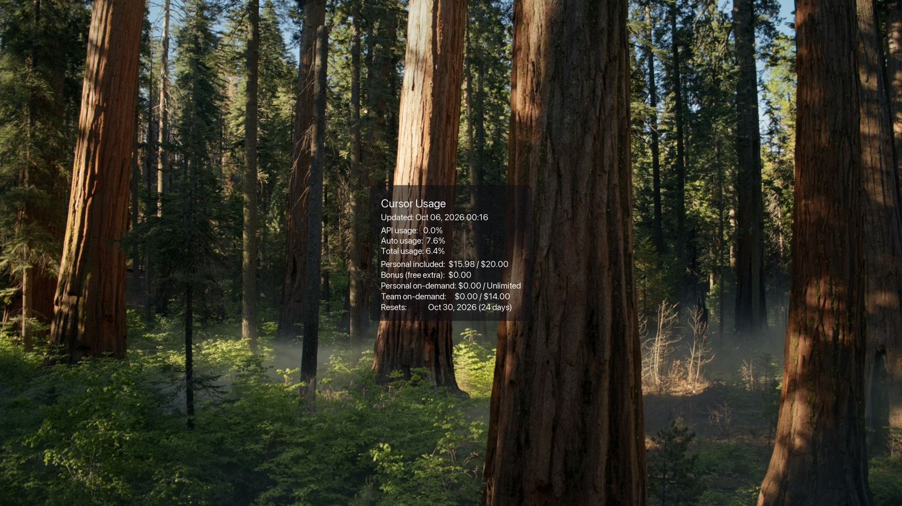

# Cursor Desktop Watermark

This app puts a small card on your Mac desktop wallpaper that shows how much of your Cursor plan you have used, and how much you have spent. It updates by itself about once an hour, so you can glance at your desktop instead of opening Cursor.

Your original wallpaper file is left alone. The app keeps a copy, draws the card on that copy, and sets the result as your desktop background.

> Unofficial tool. Not made by Cursor. It reads usage from your signed-in Cursor account.

## What it looks like



The picture above is the desktop background after the app runs. The forest photo is the wallpaper. The dark card in the middle is the usage overlay.

| Line on the card | What it means |
| --- | --- |
| **Updated** | When these numbers were last refreshed |
| **API usage** | How much of your named-model (API) allowance you have used |
| **Auto usage** | How much of your Auto model allowance you have used |
| **Total usage** | Overall included usage for this billing period |
| **Personal included** | Included plan spend so far, and your included limit |
| **Bonus (free extra)** | Extra free usage, when Cursor gives you some |
| **Personal on-demand** | Extra personal spend beyond the included amount |
| **Team on-demand** | Shared team spend, and the team limit |
| **Resets** | The day your usage period starts over, and how many days are left |

Some lines only appear when they apply to your plan.

## What you need

- A Mac
- The Cursor app, open and signed in
- A **Teams** or **Enterprise** Cursor plan

Individual plans (Pro, Pro+, Ultra) do not expose this usage data, so the app cannot show it.

You will type a few commands in **Terminal**. To open it: press **Command + Space**, type `Terminal`, and press Return.

## Set it up

Do this once. You only need to be signed in to the Cursor app. You do not need an API key.

1. In Terminal, go to this project folder. If it lives in `Custom-Apps`, that looks like:

   ```bash
   cd ~/Custom-Apps/cursor-usage-wallpaper
   ```

2. Install the app and start the hourly update:

   ```bash
   ./install.sh
   ```

   This copies a settings file if you do not have one yet, saves your current wallpaper, and schedules an update about once an hour.

3. If macOS asks for permission, allow it.

   Go to **System Settings → Privacy & Security → Automation** and let **Terminal** control **System Events**. That permission is how the app is allowed to change your desktop picture.

4. Refresh the wallpaper once, so the card appears right away:

   ```bash
   ./update_wallpaper.sh
   ```

5. Look at your desktop. You should see your wallpaper with the usage card on it.

## Change where the card sits

Settings live in a file named `config.env` in this folder. Open it with TextEdit:

```bash
open -a TextEdit config.env
```

The two settings most people change:

| Setting | What to put | What it does |
| --- | --- | --- |
| `OVERLAY_POSITION` | `center-center` | Puts the card in the middle (this is what the screenshot uses) |
| `OVERLAY_POSITION` | `bottom-right` | Puts the card in the bottom-right corner (the usual default) |
| `OVERLAY_OPACITY` | `0.6` | How solid the dark card is. `1.0` is fully solid. `0.3` is faint |

Other positions you can use: `bottom-left`, `top-right`, `top-left`, `top-center`, `bottom-center`, `center-left`, `center-right`.

Save the file, then run:

```bash
./update_wallpaper.sh
```

## You picked a new wallpaper

The card is drawn on the wallpaper the app saved the first time it ran. If you choose a new picture in **System Settings → Wallpaper**, tell the app to save that new picture:

```bash
./install.sh --refresh-base
./update_wallpaper.sh
```

Set the new wallpaper in System Settings **before** those two commands. If your desktop is still showing the usage card, the app stops and asks you to pick your real wallpaper first. That keeps a second card from being stamped on top of the first one.

## Update the numbers yourself

The card refreshes about once an hour on its own. To refresh now:

```bash
./update_wallpaper.sh
```

Cursor’s own numbers are also updated about once an hour, so running this every minute will not make them newer.

## If something looks wrong

**The desktop is a solid blue color, not your photo**

The app did not save your real wallpaper. Pick your picture in **System Settings → Wallpaper**, then run:

```bash
./install.sh --refresh-base
./update_wallpaper.sh
```

**macOS says the script is not allowed to control System Events**

Open **System Settings → Privacy & Security → Automation** and turn on **Terminal → System Events**. Then run `./update_wallpaper.sh` again.

**The numbers did not change**

Wait for the next hourly update, or run `./update_wallpaper.sh`. Cursor aggregates usage about once an hour.

**You see “401 Unauthorized”**

The app could not read your Cursor account.

- Make sure the Cursor app is open and you are signed in, then run `./update_wallpaper.sh` again.
- In `config.env`, `AUTH_MODE` should be `session` or `auto`.

**You see “429 Too Many Requests”**

The app asked Cursor for data too often. In `config.env`, set `UPDATE_INTERVAL=3600` (one hour) and wait before trying again.

## Turn it off

This stops the hourly updates. It does not delete the project folder.

```bash
launchctl bootout gui/$(id -u)/com.$(whoami).cursor-wallpaper
rm -f ~/Library/LaunchAgents/com.$(whoami).cursor-wallpaper.plist
```

Your desktop will keep showing the last picture the app set. Pick any wallpaper again in **System Settings → Wallpaper** to go back to a picture without the card.

## For people who like the technical details

### Plans

| Plan | Works? |
| --- | --- |
| Teams | Yes |
| Enterprise | Yes |
| Individual (Pro / Pro+ / Ultra) | No. Those plans have no usage API for this |

### Two ways to sign in

| Mode | When to use it |
| --- | --- |
| `session` (default) | You are signed in to the Cursor app. No API key. |
| `auto` | Try an Admin API key first, then fall back to the Cursor app session. |
| `admin` | You are a team admin and have an Admin API key. |

A key that works on `https://api.cursor.com/v1/me` is a **user** key. This app needs either the Cursor app session, or a **Teams Admin** key (`admin:*` scope) from [cursor.com/dashboard](https://cursor.com/dashboard) → **API Keys**.

If you use admin mode, set `CURSOR_API_KEY` and `CURSOR_EMAIL` in `config.env`, then lock the file down:

```bash
chmod 600 config.env
```

### What runs in the background

```text
about once an hour
  → fetch your usage
  → draw the card on the saved wallpaper
  → set that picture as the desktop background
  → keep the previous picture as a backup if an update fails
```

The saved wallpaper is `data/base_wallpaper.png`. Generated pictures are in `generated/`. Neither folder is meant to be shared.

### Handy commands

```bash
./install.sh                 # first-time setup and hourly schedule
./install.sh --refresh-base  # save a new wallpaper after you change it
./update_wallpaper.sh        # refresh the card now
tail -f ~/Library/Logs/cursor-wallpaper.log
```

### Rate limits

Cursor recommends checking usage at most about once an hour. The default `UPDATE_INTERVAL` is `3600` seconds. The hard limit on these endpoints is 20 requests per minute.

### Project layout

```text
cursor-usage-wallpaper/
├── README.md
├── docs/wallpaper-preview.jpg
├── config.env.example
├── install.sh
├── update_wallpaper.sh
├── fetch.py
├── render.py
├── capture_base.py
├── data/        # saved wallpaper and latest numbers (not shared)
└── generated/   # desktop pictures the app created (not shared)
```

## License

MIT. See [LICENSE](LICENSE).
